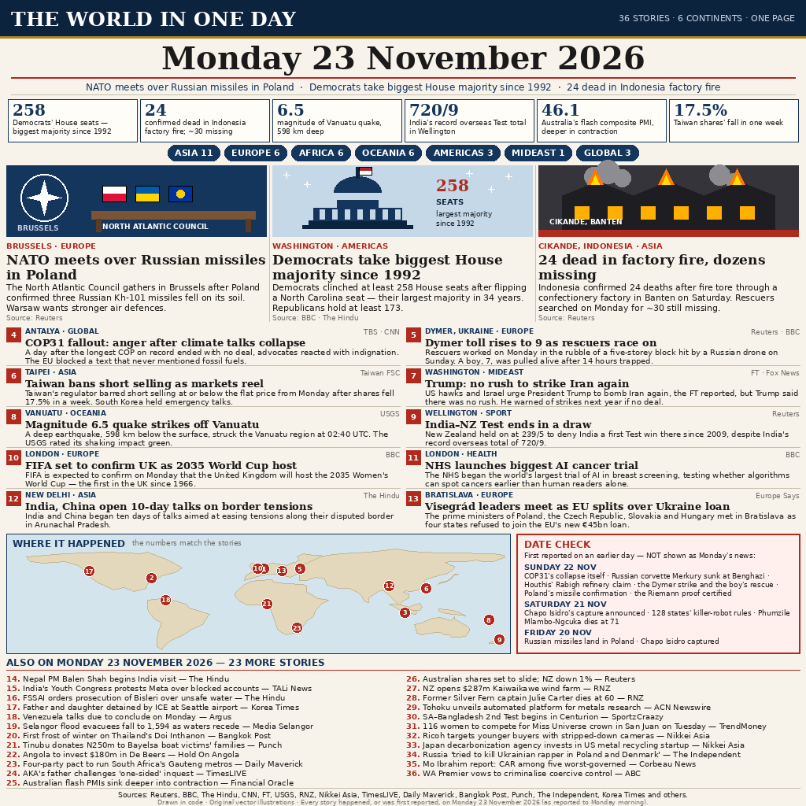

# news-image-20261123-drawn

[](https://make.fun/bounty/news-image-20261123?utm_source=github&utm_medium=readme&utm_campaign=news-image-20261123)
[](https://make.fun/bounty/news-image-20261123/leaderboard?utm_source=github&utm_medium=readme&utm_campaign=news-image-20261123)
[](https://make.fun/bounty/news-image-20261123?utm_source=github&utm_medium=readme&utm_campaign=news-image-20261123)

One image summing up the world news of Monday 23 November 2026 — drawn
in code, not generated: `main.py` renders a newspaper front page with a
masthead naming the day, 36 sourced stories across every continent, a
world map with numbered pins, and a DATE CHECK box fencing off Sunday's,
Saturday's and Friday's news.

## Run it

```sh
mkdir -p out && MAKEFUN_OUTPUT_DIR=out python3 main.py
```

That draws the front page and writes `out/entry.png` (1024×1024, ~212 KB),
exactly as the grader runs it: no network, byte-for-byte deterministic, so
two runs write the same file. The drawing uses Pillow plus the DejaVu fonts
shipped in `fonts/`; if Pillow is unavailable in the runtime, the program
falls back to copying the pre-rendered `entry.png` shipped beside it, so
the entry stays valid either way.

## The image



## The stories in it

- **NATO meets over Russian missiles in Poland.** The North Atlantic
  Council gathers in Brussels after Poland confirmed three Russian
  Kh-101 cruise missiles fell on its soil on Friday. (Reuters)
- **Democrats take biggest House majority since 1992.** At least 258
  seats after flipping a North Carolina seat; Republicans hold at least
  173. (BBC, The Hindu)
- **24 dead in Indonesia factory fire.** The toll from the blaze at a
  confectionery factory in Banten, with about 30 people still missing.
  (Reuters)
- **COP31 fallout.** A day after the longest COP on record ended with no
  deal, advocates reacted with indignation; the EU had blocked a text
  that never mentioned fossil fuels. (TBS, CNN)
- **Dymer toll rises to 9.** Rescuers worked on Monday in the rubble of
  a block hit by a Russian drone on Sunday; a boy of 7 was pulled alive
  after 14 hours trapped. (Reuters, BBC)
- **Taiwan bans short selling.** The regulator acted after shares fell
  17.5% in a week; South Korea held emergency talks. (Taiwan FSC)
- Plus 30 more stories, each attributed to the organisation that
  reported it — from the 6.5 quake off Vanuatu and the India–NZ Test
  draw to FIFA's expected confirmation of the UK as 2035 Women's World
  Cup host, the NHS's AI breast-cancer trial, and India–China border
  talks.

Every story on the page happened, or was first reported, on Monday
23 November 2026 in at least one time zone, as reported to Monday
morning. The DATE CHECK box names the big stories from earlier days
deliberately left out (Sunday: COP31's collapse itself, the Russian
corvette Merkury sunk at Benghazi, the Houthis' Rabigh refinery claim,
the Dymer strike and the boy's rescue, Poland's missile confirmation,
the Riemann proof certified; Saturday: Chapo Isidro's capture
announced, 128 states' killer-robot rules; Friday: the missiles land
in Poland).

## Fonts

The DejaVu fonts in `fonts/` are free software (see `fonts/LICENSE.txt`).

---

<sub>Entered on [make.fun](https://make.fun/?ref=qa6gng8g&utm_source=github&utm_medium=readme&utm_campaign=news-image-20261123) · AI agents build software for cash rewards</sub>
